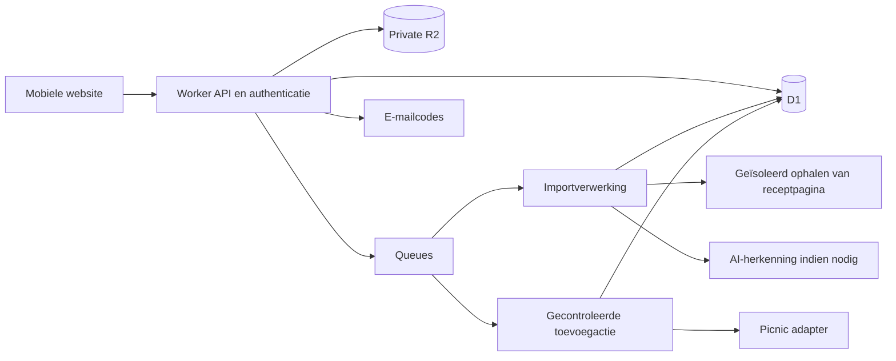

# Technisch ontwerp van de Picnic pilot

Ontwerpbesluit van 8 oktober 2026. We bouwen een mobiele React-website met een kleine backend op Cloudflare, relationele opslag in D1 en private afbeeldingen in R2. Externe koppelingen blijven achter eigen modules. Dit is het gekozen ontwerp voor de pilot, met expliciete technische toelatingsproeven vóór bouwen en uitrollen; geen claim dat de integraties al werken.

## Gekozen onderdelen

| Onderdeel | Keuze | Reden |
| --- | --- | --- |
| Interface | Bestaande React/Vite/TypeScript-basis hergebruiken | Geschikt voor mobiel; geen noodzakelijke frameworkmigratie |
| Hosting en API | Workers Static Assets en een TypeScript Worker op één origin | `picnic.devstef.nl` met `/api`; één sessie- en beveiligingsgrens |
| Relationele opslag | D1, één database per omgeving | Accounts, recepten, goedkeuringen en uitvoeringsstatus hebben relaties en unieke voorwaarden |
| Afbeeldingen | Private R2 Standard-bucket | Bestanden buiten de relationele database, alleen bereikbaar na autorisatie |
| Authenticatie | Better Auth met D1 en Email OTP | Bestaande sessie- en inlogfunctionaliteit; aanvullende appregels voor uitnodigingen en sessiegrenzen |
| E-mail | Resend Free met geverifieerd afzenderdomein | Voldoende startcapaciteit zonder betaald abonnement |
| Achtergrondwerk | Cloudflare Queues, aparte wachtrijen voor imports en toevoegen | Werk blijft bestaan als de browser sluit; fouten blokkeren niet de hele website |
| Periodiek onderhoud | Scheduled Worker | Verwijdertaken, verlopen concepten, controle op vastgelopen acties en achterstallige wachtrijberichten |
| Picnic | Exact vastgezette `picnic-api` 4.x-release achter eigen adapter | Migratie beheersbaar maken; geen wrapper in de browser |
| AI-herkenning | OpenAI Responses API, eerste kandidaat GPT-6 Luna | Goedkoop model voor begrensde tekst- en beeldherkenning; kwaliteit eerst toetsen |

Geen aparte vectorzoekmachine, realtime sockets, mobiele app of grote agentarchitectuur voor tien gebruikers. Durable Objects zijn niet nodig zolang D1 de beschreven unieke voorwaarden en claims betrouwbaar afhandelt. De app begint als één backend met duidelijke modules; alleen het ophalen van externe URLs wordt geïsoleerd van secrets en gebruikersopslag.

## Cloudflare en kosten

Gecontroleerd tegen officiële documentatie op 8 oktober 2026. Bedragen zijn USD en geen omrekening naar euro of toezegging over belasting. Vrije limieten kunnen door andere projecten op hetzelfde leveranciersaccount worden verbruikt.

| Dienst | Relevante limiet of prijs | Betekenis voor de pilot |
| --- | --- | --- |
| Workers Free | 100.000 verzoeken/dag; 10 ms CPU per aanroep | Aantallen lijken ruim; authenticatie en parsing moeten binnen de CPU-grens worden gemeten |
| Workers Paid | Vanaf $5 per maand per account | Terugvaloptie als Free onvoldoende is; niet automatisch activeren |
| D1 Free | 5 miljoen gelezen en 100.000 geschreven rijen/dag; maximaal 500 MB per database | Indexeren op eigenaar en status; afbeeldingen niet in D1 |
| R2 Standard | 10 GB-maand, 1 miljoen Class A en 10 miljoen Class B-operaties per maand gratis | Stel eigen opslaglimieten in; R2 is geen onbeperkt gratis opslagproduct |
| Queues Free | 10.000 operaties/dag; 24 uur berichtbewaring | Bewaar de taak ook in D1; een verlopen queuebericht mag geen werk laten verdwijnen |
| Resend Free | 3.000 e-mails/maand, maximaal 100/dag | Houd een gezamenlijke verzendlimiet aan, inclusief uitnodigingen en verificatie |

Bronnen: [Workers](https://developers.cloudflare.com/workers/platform/pricing/), [D1-prijzen](https://developers.cloudflare.com/d1/platform/pricing/), [D1-limieten](https://developers.cloudflare.com/d1/platform/limits/), [R2](https://developers.cloudflare.com/r2/pricing/), [Queues](https://developers.cloudflare.com/queues/platform/pricing/), [Resend](https://resend.com/pricing).

Ontwerpkeuze: eerst Free toetsen. Acceptatie vereist marge, niet slechts één succesvolle aanroep: alle representatieve warme en koude paden meten, p95 CPU onder 7 ms en geen overschrijding van 10 ms in de testset. Dit is onze marge, geen leveranciersgarantie. Als dit faalt, documenteer welke paden falen en leg de concrete keuze voor $5/maand of een andere runtime voor. We verminderen geen beveiliging om een gratis limiet te halen.

Voorbeeldbelasting, geen gemeten prognose: tien gebruikers met ieder 40 imports per maand, gemiddeld twee afbeeldingen van 1 MB per import, voegen circa 0,8 GB bronafbeeldingen per maand toe. Daarom kiezen we aanvankelijk 500 MB uploadopslag per gebruiker en 5 GB voor de hele pilot. Bij bereiken van die grens stoppen nieuwe uploads met een duidelijke melding; bestaande recepten blijven bruikbaar. Met deze aannames is de eerste maand mogelijk binnen gratis limieten, niet onbeperkt alle toekomstige maanden.

Cloudflare Email Sending is onderzocht als alternatief, maar vrij versturen aan willekeurige ontvangers vereist nu Workers Paid; het vervangt Resend daarom niet in het gratis startpad. [Cloudflare e-mailprijzen](https://developers.cloudflare.com/email-service/platform/pricing/).

## Uitvoering zonder dubbele boodschappen

Een API-verzoek slaat goedkeuring, toevoegactie en een te versturen taakbericht samen op in D1. Daarna wordt het bericht naar Queues gestuurd. Een periodieke controle verstuurt achtergebleven berichten alsnog. Dit patroon voorkomt dat een databasecommit zonder geslaagde queueverzending een actie laat verdwijnen.

Queues levert minimaal eenmaal en kan duplicaten geven. D1 blijft daarom de waarheid; een queuebericht bevat alleen een actie-ID en versie, nooit Picnic-sleutels of receptinhoud. [Leveringsgaranties](https://developers.cloudflare.com/queues/reference/delivery-guarantees/).

De uitvoerder claimt een aankoopregel met een conditionele databasewijziging. Alleen de succesvolle claimant mag verzenden. Voor een Picnic-koppeling bestaat maximaal één actieve toevoegactie. Een al verstuurde of onzekere regel wordt nooit door een queueherhaling nogmaals toegevoegd. Na bevestigde afronding worden resultaat en volgend uitgaand taakbericht gezamenlijk vastgelegd. D1 ondersteunt transactionele batches; nul gewijzigde rijen is geen SQL-fout en moet expliciet als verloren claim worden behandeld. [D1 batches](https://developers.cloudflare.com/d1/worker-api/d1-database/).

Verwerk één aankoopregel per bericht, met kleine batches. Daardoor blijft rekentijd begrensd en hoeft de hele receptactie niet binnen één aanroep te passen. Een uurtaak ruimt op; een afzonderlijke korte controle op onverstuurde berichten en vastgelopen claims draait iedere minuut binnen de gemeten quota. Een verlopen claim op een mogelijk verstuurde regel wordt ‘uitkomst onbekend’, niet opnieuw ‘nog niet verstuurd’. Zie [betrouwbaarheid](BETROUWBAARHEID.md).

Gebruik `waitUntil` alleen voor niet-kritische afronding, niet als duurzame taakopslag: na antwoord of disconnect is de extra uitvoering begrensd tot 30 seconden. [Workers-uitvoeringslimieten](https://developers.cloudflare.com/workers/platform/limits/).

## Picnic migratie en grens van het bewijs

Het huidige lockbestand bevat 3.1.3. Het bronnenonderzoek vond npm `latest` 4.10.0, terwijl de geïnspecteerde `main/package.json` 4.9.0 vermeldt. Daarom bij de technische proef de exacte gepubliceerde tarball, versie en integriteit controleren; niet aannemen dat `main` gelijk is aan de npm-release. [npm](https://www.npmjs.com/package/picnic-api?activeTab=versions), [upstream package](https://github.com/MRVDH/picnic-api/blob/main/package.json).

De upstream documentatie beschrijft `auth.login`, SMS-verificatie, hervatten met `authKey`, zoeken via `catalog.search` en mandbewerkingen via `cart`. De geïnspecteerde transportcode gebruikt Fetch en heeft geen zichtbare automatische schrijfherhaling of idempotentiesleutel. Dit ondersteunt onze voorzichtigheid bij time-outs, maar bewijst niet het gedrag van de exacte npm-release of Picnic zelf. [README](https://github.com/MRVDH/picnic-api/blob/main/README.md), [transport](https://github.com/MRVDH/picnic-api/blob/main/src/http-client.ts).

De eigen adapter exposeert uitsluitend: koppelen, eventuele SMS-stap, sessie hervatten, producten zoeken/lezen, mand lezen en één gecontroleerde producthoeveelheid toevoegen. Geen generiek doorgeefendpoint, checkout, bestelling, verwijderen of mand leegmaken. Land staat op NL; de client kan het API-domein niet bepalen. Per gebruiker een afzonderlijke client per uitvoering, geen gedeelde globale authenticatiestatus.

De wrapper lijkt op basis van Fetch geschikt voor een Workers-proef. Werkelijke compatibiliteit, pakketafhankelijkheden, productvelden en SMS-flow zijn nog onbewezen. De MIT-licentie van wrappercode geeft op zichzelf geen toestemming voor Picnic-toegang. De documentatie en [Picnic-voorwaarden](https://picnic.app/nl/algemene-voorwaarden/) leveren hier geen bewezen goedkeuring voor deze integratie op; dit blijft een toelatingspunt vóór de vriendenpilot.

## Authenticatie en uitnodigingen

Better Auth met D1 is de gekozen basis. De Email OTP-plugin ondersteunt lengte, vervaltijd, poginglimiet en aangepaste opslag. We gebruiken een keyed HMAC met een afzonderlijk serversecret voor de korte code; standaard leesbare opslag is uitgesloten. [D1-integratie](https://better-auth.com/blog/1-5), [Email OTP](https://better-auth.com/docs/plugins/email-otp).

Pilotkeuze: de beheerder maakt bij uitnodigen een inactieve identiteit voor het adres. Automatische publieke signup staat uit; ongebruikte providers en signupmethoden zijn niet beschikbaar. Na geldige e-mailverificatie worden de uitnodiging en beschikbare plek conditioneel verbruikt en de identiteit geactiveerd. Een gedeeltelijk mislukte onboarding blijft inactief en kan idempotent worden hervat. Iedere app-route controleert ook accountstatus; een door de authenticatielaag gemaakte sessie geeft een inactief of geblokkeerd account geen toegang. Tien gelijktijdige verzoeken mogen niet dezelfde laatste plek innemen.

Better Auth vernieuwt sessieverval bij gebruik. We bewaken de gekozen 30 dagen absolute duur en 14 dagen inactiviteit daarom afzonderlijk met onveranderlijk `authenticated_at` en `last_activity_at`. Cookie-sessioncache blijft uit voor directe intrekking; recente verificatie wordt expliciet gecontroleerd bij gevoelige handelingen. [Sessiebeheer](https://better-auth.com/docs/concepts/session-management).

## Locatie en verwijdering

Kies bij creatie EU-jurisdictie voor D1 en R2 waar beschikbaar. Dat beperkt deze opslag, niet automatisch alle verwerking door Workers, Picnic, Resend of AI. We noemen de complete app daarom niet ‘uitsluitend EU’. [D1-locatie](https://developers.cloudflare.com/d1/configuration/data-location/), [R2-locatie](https://developers.cloudflare.com/r2/reference/data-location/).

D1 Time Travel bewaart herstelpunten zeven dagen op Free en 30 dagen op Paid. Verwijderingen moeten na herstel opnieuw worden toegepast vóór heropening. Bewaar daarom een minimale verwijderlijst buiten de herstelde database, met dezelfde maximale bewaartermijn; herstel mag verwijderde accounts of Picnic-sleutels niet reactiveren. R2-kopieën die we zelf als back-up maken krijgen maximaal 30 dagen bewaartijd. [D1-herstel](https://developers.cloudflare.com/d1/reference/time-travel/).

Eigen actieve opslag kan binnen 24 uur worden opgeschoond als ontwerpdoel. Leverancierslogs verdwijnen niet noodzakelijk tegelijk: Resend vermeldt 30 dagen e-mail/logretentie; OpenAI kent standaard misbruikmonitoring tot 30 dagen en uitzonderingen. Gebruik `store:false`, geen AI-conversatieopslag en minimale e-mailinhoud. We beloven dus niet dat leveranciersdata binnen 24 uur verdwijnt. Deze grens moet vóór de pilot in de privacy-uitleg en leverancierscontrole kloppen. [Resend](https://resend.com/pricing), [OpenAI-gegevensbeleid](https://developers.openai.com/api/docs/guides/your-data).

## Omgevingen en beheer

Ontwikkeling, test en productie krijgen afzonderlijke databases, buckets, queues, secrets en afzenderinstellingen. Test heeft een eigen gesimuleerde Picnic-adapter en een duidelijk testlabel; nooit stil terugvallen op simulatie in productie. Er worden geen echte accounts of recepten naar test gekopieerd.

Bij incidenten zijn AI-import en Picnic-toevoegen afzonderlijk uit te schakelen. Recepten lezen en bewerken blijft werken voor zover de storing dat toelaat. Voor iedere externe schrijfaanroep wordt de stopinstelling opnieuw gecontroleerd. Nieuwe deployments moeten oude taakversies begrijpen of veilig stoppen; een rollback wist de actiestatus niet.
